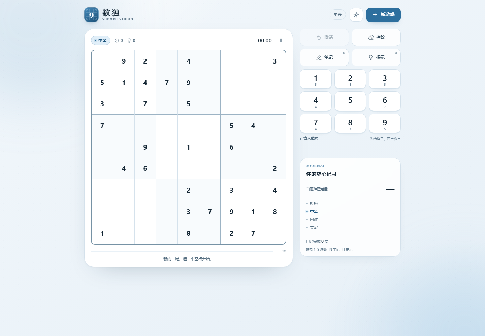

# 数独 · 一局静心

一个不依赖框架、打开即玩的数独网页版。白蓝瓷感配色，手机与电脑共用一套界面，自动适配横竖屏，并已支持安装到手机主屏幕、离线游玩。

**在线试玩：** <https://kriye-hu.github.io/sudoku-studio/>

**Android APK：** [下载安装包](https://github.com/Kriye-hu/sudoku-studio/releases/latest/download/sudoku-studio-1.0.0.apk) · 无需 Chrome、Google Play 或谷歌服务，Android 8.0+。

<a href="https://github.com/Kriye-hu/sudoku-studio/releases/latest/download/sudoku-studio-1.0.0.apk">
  
</a>

[](https://github.com/Kriye-hu/sudoku-studio/actions/workflows/android.yml)



## 打开方式

电脑上直接双击 `index.html`，或把它拖进 Chrome / Edge 即可。无需安装、无需构建、无需联网。

**Android 用户：** 直接下载上面的 APK 安装即可，不依赖谷歌浏览器或 Google 服务。

**iPhone / 想用网页版：** 需要把整个文件夹部署到 HTTPS 静态站点，具体步骤见 [INSTALL.md](INSTALL.md)。

```
sudoku/
├─ index.html            页面结构、安装入口与中文文案
├─ styles.css            响应式布局、明暗主题、动画
├─ sudoku.js             数独生成器与唯一解校验（浏览器 / Node 通用）
├─ app.js                游戏状态、交互、计时、存档、安装引导
├─ manifest.webmanifest  PWA 应用信息
├─ sw.js                 离线缓存 Service Worker
├─ icons/                手机桌面与主屏幕图标
├─ android/              Android WebView 原生壳工程
├─ .github/workflows/    自动构建并签名 APK
├─ INSTALL.md            部署与安装到手机的完整说明
├─ README.md
└─ preview/              桌面、手机与安装界面预览图
```

## 已实现

- **四种难度**：轻松 / 中等 / 困难 / 专家，每次即时生成，并保证唯一解。
- **完整操作**：数字键、笔记、擦除、撤销、提示。
- **专注计时**：首次操作才开始计时；暂停、切换页面时自动停表。
- **进度保存**：自动存入浏览器 `localStorage`，刷新或关掉再打开可继续。
- **记录**：各难度最佳时间与完成局数。
- **反馈**：错误即时标红并计数；同行、同列、同宫、同数字自动高亮。
- **桌面键盘**：`1–9` 填数、`N` 笔记、`H` 提示、`Backspace` 擦除、`Ctrl/Cmd+Z` 撤销、空格暂停、方向键移动。
- **手机适配**：9 键数字条、横屏双栏、小屏 320px 可用。
- **明暗主题**：默认跟随系统，也可手动切换并记住选择。
- **可安装 App**：Android APK（无需谷歌服务）、iPhone 添加到主屏幕引导、独立全屏运行。
- **离线游玩**：APK 自带全部资源；网页版通过 Service Worker 缓存，断网后仍可继续玩。
- **自动构建**：GitHub Actions 生成签名 APK，签名密钥只保存在仓库 Secrets 中。

## 一点说明

难度目前按提示数近似划分，每次生成的提示数会在目标值附近浮动；所有题目都经过唯一解校验，不会出现多解。下一版可以继续加入：

- PWA 安装与离线缓存
- 按解题技巧（唯一候选、数对、链等）区分难度
- 每日挑战、云端同步或多人对战
- 音效与更细的动画反馈
